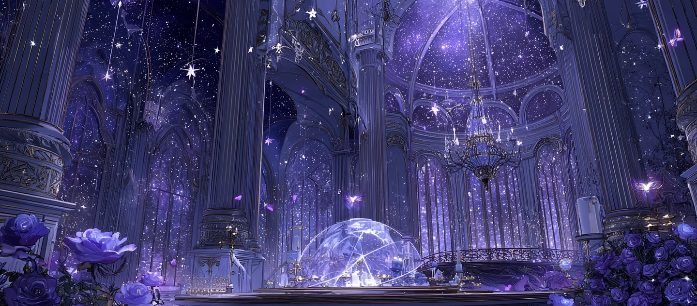
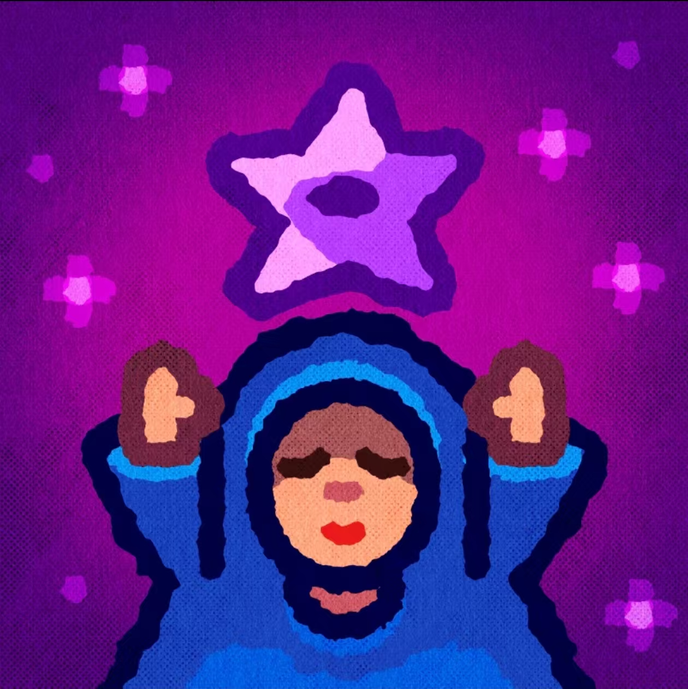
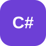

  
     
  
    
  <h1>Hi, I'm Zishuo Pang.</h1>
  
<strong>Unity · VR · Game Interaction · AIGC</strong>

  
I make interactive projects, visual experiments, and prototypes that are easy to understand and fun to try.

  
<a href="./README.zh-CN.md">中文对照</a>

  
  

<h2>About</h2>

I enjoy making interactive things and then polishing the details that make them feel clear: the first-time experience, the input feedback, the visual rhythm, and the way a project is presented.

My work moves between Unity games, VR interaction, 3D assets, generative image restoration, mobile applications, and physical mechanism prototypes. Each repository is organized as a small, reviewable project with its own screenshots, videos, notes, or release files.

<h2>Project Showcase</h2>

<table>
  <tr>
    <td width="50%" valign="top">
      <strong><a href="https://github.com/gouxiana/Qiaomu-Joinery-Unity-VR-Assembly-Game">Qiaomu Joinery · Unity VR Assembly</a></strong> 
      Meta Quest 榫卯拼装体验：用手部追踪和微手势完成结构组合，关注交互响应与操作负担。 
      Unity · Meta Quest · Hand Tracking · Micro-gesture Interaction
    </td>
    <td width="50%" valign="top">
      <strong><a href="https://github.com/gouxiana/Water-Power-Unity-VR-Game">Water Power · Unity VR Game</a></strong> 
      把古代水利结构变成可观察、可拼装、可操作的 VR 学习体验。 
      Unity · Meta Quest · Spatial Interaction
    </td>
  </tr>
  <tr>
    <td width="50%" valign="top">
      <strong><a href="https://github.com/gouxiana/Hollow-Knight-Unity-2.5d-Game">Hollow Knight · Unity 2.5D Game</a></strong> 
      横版动作游戏练习，围绕角色移动、战斗反馈、探索节奏和关卡推进展开。 
      Unity · 2.5D · Action Game
    </td>
    <td width="50%" valign="top">
      <strong><a href="https://github.com/gouxiana/Food-Entrepreneur-unity">Food Entrepreneur · Unity Simulation</a></strong> 
      从顾客点餐到制作、出餐和结算，搭建一套直观的餐饮经营循环。 
      Unity · Simulation · Game Design
    </td>
  </tr>
  <tr>
    <td width="50%" valign="top">
      <strong><a href="https://github.com/gouxiana/Through-Time-Color-AIGC">Through Time Color · AIGC Restoration</a></strong> 
      以残缺古画为对象，探索 ControlNet、图生图与人工筛选结合的色彩修复流程。 
      AIGC · ControlNet · Image Restoration
    </td>
    <td width="50%" valign="top">
      <strong><a href="https://github.com/gouxiana/Cornerstone-Bipedal-Stair-Climbing-Mechanism">Bipedal Alternating Stair-Climbing Mechanism</a></strong> 
      双足交替式爬楼机构：从机构构型、运动仿真到 3D 打印样机验证。 
      Mechanism Design · Motion Simulation · 3D Printing
    </td>
  </tr>
  <tr>
    <td width="50%" valign="top">
      <strong><a href="https://github.com/gouxiana/harmonyos-campus-ordering">Campus Ordering · HarmonyOS App</a></strong> 
      面向校园外卖场景的点餐应用，整理从浏览、下单到取餐的核心流程。 
      HarmonyOS · Mobile Application · Product Flow
    </td>
    <td width="50%" valign="top">
      <strong>More prototypes in progress</strong> 
      Unity 小项目、交互实验和视觉素材会继续整理并公开。 
      Prototypes · Experiments · Work in Progress
    </td>
  </tr>
</table>

<h2>Tools &amp; Software</h2>

<strong>Game &amp; Interaction</strong>

<table><tr>
  <td align="center"> Unity</td>
  <td align="center"> C#</td>
  <td align="center"> Meta Quest</td>
  <td align="center"> Git</td>
</tr></table>

<strong>3D &amp; Modeling</strong>

<table><tr>
  <td align="center"> Maya</td>
  <td align="center"> 3ds Max</td>
  <td align="center"> Substance 3D Painter</td>
  <td align="center"> SolidWorks</td>
  <td align="center"> Marmoset Toolbag</td>
</tr></table>

<strong>Visual &amp; Content Production</strong>

<table><tr>
  <td align="center"> Photoshop</td>
  <td align="center"> CapCut · 剪映</td>
  <td align="center"> Canva · 可画</td>
  <td align="center"> Xiumi · 秀米</td>
</tr></table>

<h2>Highlights</h2>

- **Patent:** Co-inventor of a utility model patent for a bipedal alternating stair-climbing mechanism.
- **Award:** CMIT Competition, AIGC Track, Municipal Third Prize.
- **End-to-end making:** concept, interaction, assets, implementation, testing, documentation, and demo delivery.
- **Cross-medium practice:** games, VR experiences, a HarmonyOS application, AIGC restoration, and a mechanical prototype.
- **Public archive:** selected projects include readable notes and supporting visual or video material.

<h2>Contact</h2>

  
  

